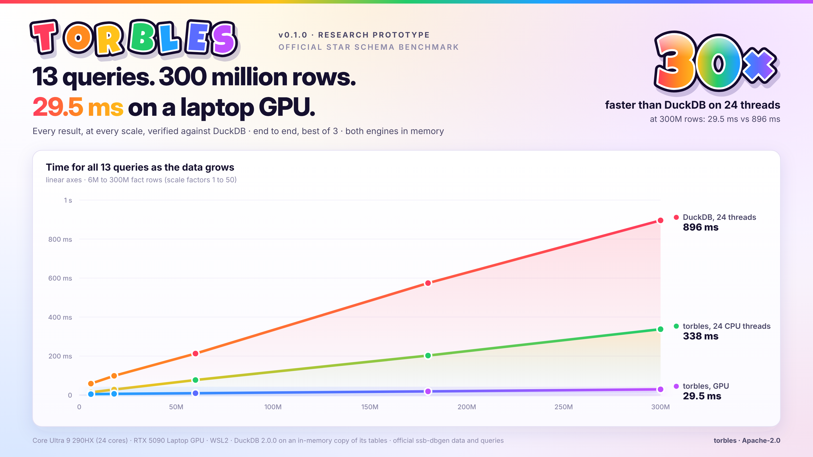

# torbles

**An algebraic relational datastore on torus-encoded bit planes.** Version 0.2.0, alpha: you can install it, load
your own tables with their types and keys, and get answers checked against DuckDB. Features are still missing and
the API may change (see [Known limitations](#known-limitations-020)).

A *torble* is a toroidal table: it stores every column as bit planes (plane j holds bit j of 64 rows per machine
word) laid out on a torus whose faces are XOR checks, so every row is protected and single-bit faults are found and
repaired. Queries are not executed row by row. They are compiled into algebra over the planes:

- **Filters** are Boolean polynomials over the planes, evaluated 64 rows per instruction.
- **SUM** is popcount algebra: `SUM(x) = sum_j 2^j popcount(x_j & F)`. Products of columns use pairs of planes.
- **An equi-join is a substitution.** A dimension filter is a polynomial in the primary key's bits. Replacing the
  primary key with the foreign key evaluates the join directly on the fact's planes: no hash table, no probe.
  Hierarchical keys turn filters into a few cubes (ANDs of literals) or comparators.
- **The key layout is found from the data.** At load, torbles finds each dimension's hierarchy (functional
  dependencies such as city -> nation -> region) and stores it in the foreign keys' bits, so the joins above apply to
  your schema without hand design.
- **Range, band and inequality joins** use the same comparator polynomial, with dominance sums for aggregation.
- **GROUP BY is one matrix product**, `C = M^T X` (group masks AND-popcount measure planes), with sparse output.
- **Optional GPU executor (CUDA).** One thread per 64-row word, a sparse group table on the GPU, and optional
  tensor-core b1 MMA kernels. On an RTX 5090 Laptop GPU, the 13 official SSB queries on 300 million rows ran in
  29.5 ms end to end (0.1.0), against 896 ms for DuckDB on 24 threads (in memory).

Every result is checked against DuckDB: by the test suite, and by a differential fuzzer that generates random typed
schemas and queries and compares every answer (`python -m torbles.fuzz`).

## Quick start

Requirements: Linux x86-64 (or WSL2), a C and C++ compiler, Python 3.9+. Optional: nvcc for the GPU executor.

    pip install .            # builds the engine for this machine (and the CUDA executor if nvcc is found)

or, working in the repository: `make` (engine), `make test` (every test, about a minute and a half), `make gpu`.

```python
import torbles

# keys from a standard SQL schema; data from files, data frames or a DuckDB database
db = torbles.from_ddl("""
    CREATE TABLE customer (c_id INTEGER PRIMARY KEY, region VARCHAR, nation VARCHAR, city VARCHAR);
    CREATE TABLE sales (s_cust INTEGER REFERENCES customer (c_id), day DATE, amount DECIMAL(12, 2), qty INTEGER);
""", {"customer": "customer.csv", "sales": "sales.parquet"})

s, c = db["sales"], db["customer"]
q = (db.query(s).join(c)
       .where((c.region == "EUROPE") & s.day.between("2024-01-01", "2024-03-31"))
       .group_by(c.nation)
       .sum(s.amount * s.qty))
q.run()              # {('FRANCE',): Decimal('81234.50'), ...}   "gpu" runs it on CUDA
q.sql()              # the same query in your schema's SQL;  db.verify(q) runs it on DuckDB and compares
print(db.describe()) # column types, and the key design found for each dimension

db.save("shop.torbles")                    # one file per torble, memory-mapped on load
db = torbles.load("shop.torbles")          # every torus face checked; single-bit faults repaired
```

Other ways in: `torbles.from_duckdb("my.duckdb")` (keys from its declared constraints, or `schema="schema.sql"`),
`torbles.from_frictionless("datapackage.json")` (Frictionless Table Schema keys for CSV / Parquet), and
`torbles.from_frames({...}, primary_keys=..., foreign_keys=...)`.

### Your data

- **Keys** come from standard schema declarations: `PRIMARY KEY` / `FOREIGN KEY ... REFERENCES` in SQL DDL, read
  through the standard `INFORMATION_SCHEMA` views of the source, or a Frictionless Data Table Schema next to the
  files. Keys can also be given as arguments. Guessing keys from column names and values is opt-in
  (`build(infer_keys=True)`) and reported in `db.notes`, because a wrong guess silently changes what joins.
  Foreign keys are not enforced: a reference without a match (or NULL) never joins, as in an SQL inner join.
- **Types**, each stored as an order-preserving code, so comparisons become intervals of codes:

  | SQL type | stored as | in queries |
  |---|---|---|
  | TINYINT ... BIGINT, UBIGINT, HUGEINT | value - minimum (64-bit ranges in self-extending columns) | compare, group, sum |
  | DECIMAL(p, s) | value x 10^s - minimum | compare, group, sum (exact: sums come back as `Decimal`) |
  | DATE, TIMESTAMP | days / microseconds - minimum | compare (`date`, `datetime` or ISO strings), group |
  | BOOLEAN | 0 / 1 | compare, group |
  | VARCHAR | rank in the sorted dictionary | `=`, `<`, `between`, `isin`, `startswith`, group |
  | DOUBLE, FLOAT | rank in the sorted values | compare, group (to sum one exactly, load it as DECIMAL: `types=`) |

  A referenced table's integer or decimal column whose values span more than 32 bits is stored as its rank; it can
  still be summed (the histogram bridge sums the rest of the measure per value and multiplies exactly).

  Constants are compared exactly, as SQL does: `price > 10.005` on a DECIMAL(10, 2) column, a 64-bit integer against
  a 64-bit key, a timestamp against a DATE. Sums are exact at any width: 64-bit when they fit, 128-bit past that,
  and past 128 bits through the histogram bridge (below).
- **NULLs** are refused at load, except in foreign keys (they never join); `fill_nulls={"t.col": value}` replaces
  them. Unsupported column types (BLOB, LIST, INTERVAL, ...) are skipped with a note.
- **Key design.** For every referenced table, torbles finds the longest chain of functional dependencies among its
  low-cardinality columns (on the full data), ranks each level within its parent and stores
  `hierarchy cell << w | row` in the foreign keys (`row` = the rank of the primary key, so the key itself stays a
  projection of the low bits). If the fields do not fit 32 bits, the cell is replaced by its dense rank, then levels are
  dropped; with nothing left, the foreign key is the plain row. `db.describe()` shows the result, for example on SSB:

      customer:  derived surrogate, 25 bits = c_region 3 | c_nation 3 | c_city 4 | row 15
      part:      derived surrogate, 30 bits = p_mfgr 3 | p_category 3 | p_brand1 6 | row 18

- **Integrity on load.** A saved torble carries its torus faces: on load, every face is recomputed from the stored
  planes, single-bit faults are repaired in memory, and a row with more than one lost bit is refused. Headers are
  hashed; truncated files are refused. Saving writes new files and renames them, so open databases are unaffected.
  SSB SF1 (6M rows): saved in 0.5 s (312 MiB), loaded with every face validated in 0.1 s from the page cache,
  against 2.4 s to build it from DuckDB.

### Engine-level API

The typed API is built on the engine's own API (`torbles/algq.py`), which works on uint32 columns and hand-made keys:

- `Table(name, columns, msb=, refs=, extend=, virtual=)`, `Surrogate(w, s_of_row)`
- `Query(fact).join(dim, fk).where(pred).group_by(...).sum(expr) / .count()`
- `.join_range(dim, x, lo, hi)` and `.join_ineq(dim, x, op, y)`
- `set_threads(n)` (default: all cores), `set_build_threads(n)`, `set_groupby("mm" | "split")`, `gpu_mm("word" | "popc" | "mma")`

`torbles/blobcol.py` has `BlobStore` for CLOB/BLOB columns. The engine is `torbles/alg.c` (CPU) and `torbles/gpu.cu`
(CUDA), sharing `torbles/torble.h`.

### Differential fuzzing

    python -m torbles.fuzz --minutes 10          # or: torbles-fuzz --seed 42 --cases 200 (needs pandas: pip install '.[test]')

Random star schemas (1 to 3 dimensions with hierarchies; signed, 64-bit and unsigned integers, decimals, dates,
timestamps, strings with quotes and Unicode, booleans, doubles; orphaned and NULL references, extreme and constant
values, empty tables, sizes around word and tile boundaries) and random queries (every comparison, `IN`, prefix,
`NOT` and `OR`; GROUP BY on fact and dimension columns; COUNT or SUM of random polynomials with decimal constants), run
on randomly chosen engines and planner settings, saved and reloaded, with a flipped bit repaired on load. Any answer
that differs from DuckDB's, and any exception other than a documented refusal, is a failure with a one-line replay
command. Before this release the fuzzer found seven bugs, all fixed: an empty fact table crashing the join planner,
64-bit keys compared through floating point, decimal scaling overflowing at DECIMAL(18), 64-bit timestamps in
dimensions, GROUP BY on a 64-bit column after reloading, the group count overflowing 63 bits, and a GROUP BY with
exactly 2^64 groups on the GPU path. The final record, six seeds of 800 cases (4,806 random schemas, 162,325 queries),
compared 149,176 answers with DuckDB's and found no mismatch and no unexpected error. torbles refused 119 queries
(0.07%, all GROUP BY keys needing more than 128 bits together); DuckDB rejected 13,030 (8%, overflow in its own
BIGINT and DECIMAL(18) arithmetic, which torbles evaluates exactly). Every engine mode passes the same way
(results/fuzz).

## Results

### SSB with nothing designed by hand (0.2.0), and CPU performance

`bench/ssb/ssb_auto.py` loads the official SSB database with `torbles.from_duckdb`, takes the keys from the standard
DDL in `bench/ssb/schema.sql`, lets the key design find the layout, and writes the 13 official queries with the values
as they appear in the data (`p_category == "MFGR#12"`). Every result equals DuckDB's answer to the official SQL, and
only answers that do are timed (a refused, failed or different answer is reported and left out of the totals).

CPU only, SF1 (6M rows), a 2-vCPU cloud VM (AVX2), both engines in memory. This machine is noisy (single runs of the
same configuration vary by up to 25%), so the configurations were run in four interleaved rounds and each query's best
time over the rounds is kept; ms:

| | DuckDB | torbles 0.1.0, hand-designed keys | 0.2.0 before the GROUP BY bridges, hand-designed keys | same, automatic keys | **torbles 0.2.0, automatic keys** |
|---|---|---|---|---|---|
| 13 SSB queries, 1 thread | 478.0 | 189.3 | 185.8 | 205.2 | **213.1** |
| 13 SSB queries, 2 threads | 310.8 | 112.7 | 111.2 | 122.4 | **114.8** |
| M1-M3 (unfiltered GROUP BY, every row), 1 thread | 414.1 | 507.0 | 500.8 | 543.3 | **179.2** |
| M1-M3, 2 threads | 228.3 | 259.4 | 271.5 | 269.6 | **96.1** |

(The last column is from the bridges' ablation, three rounds of its own; the others from an earlier four-round run.)

- **The 13 SSB queries:** torbles' CPU engine is 2.2-2.7x DuckDB with the automatic keys (2.5-2.8x with the
  hand-designed ones). In 0.1.0, on 24 cores and 6M to 300M rows, it was 2.6-4.1x (below).
- **The dense GROUP BY is no longer the CPU's weak spot.** M1-M3 group every row (M3: `GROUP BY d_year, lo_discount`,
  `SUM(lo_extendedprice * lo_discount)`, every one of its 77 groups in every 4096-row tile). Before the bridges they
  took 543 ms against DuckDB's 414: each tile multiplied 24 x 4 plane pairs per group. Two bridges between the plane
  algebra and per-row arithmetic fixed it: factoring the measure through the GROUP BY key (M3's second factor is a key)
  and a row kernel (one 64 x 64 bit transpose per 64 rows packs every row's keys and measure into one word), chosen per
  tile by the cost model. M1-M3 now take 179 ms, 2.3x faster than DuckDB; M3 alone 59.9 ms against 68.4. Two other
  bridges (a Shannon splitting tree, Moebius inversion over the key bits) lost in the ablation and are off
  (docs/ENGINE.md, docs/SSB.md).
- **Automatic keys cost about 10%** against the hand design, almost all of it in Q1.3 (week of the year: the hand
  design had the day in the key's fields, the automatic one finds it only in the row bits) and Q4.1-Q4.2 on one thread.

Loading SF1 takes 2.4 s with the automatic design (DuckDB read, types, key design, build) against 1.3 s for the
hand-written loader, which reads fewer dimension columns. The planner reads which bits each attribute occupies from
the key design, so first runs no longer pay for discovering them (first runs of the 13 queries: 286 ms, against 141 ms
warm, on 2 threads).

### SF10 on the laptop (0.2.0): Core Ultra 9 290HX (24 cores) and RTX 5090 Laptop GPU

`bash wsl/run_validation.sh 10` builds the engine and the CUDA executor, runs every test (the GPU tests on the GPU),
and benchmarks SSB SF10 (60M rows) with the hand-designed keys and with the automatic ones. Every test passed and every
result equals DuckDB's. Best of 3, ms, the same laptop for both releases:

| | DuckDB 1 thread | DuckDB 24 threads | torbles CPU, 1 thread | torbles CPU, 24 threads | torbles GPU |
|---|---|---|---|---|---|
| 13 SSB queries, 0.2.0 | 2164.6 | 223.4 | 892.2 | 79.4 | 10.7 |
| 13 SSB queries, 0.1.0 | 2708.1 | 246.5 | 887.9 | 83.2 | 10.3 |
| M1-M3, 0.2.0 | 2001.9 | 139.4 | **871.3** | **59.7** | **13.7** |
| M1-M3, 0.1.0 | 2386.5 | 159.8 | 2471.8 | 181.5 | 21.3 |

The GROUP BY bridges take M1-M3 on 24 CPU threads from 182 to 60 ms (DuckDB 139); M3 alone from 84 to 17.8 ms (DuckDB
19.4), and on the GPU from 12.4 to 5.2 ms, since factoring the measure through the key happens in the planner. With
the automatic keys (`torbles.from_duckdb`, loaded in 7.5 s): the 13 queries in 80.1 ms on the CPU and 9.1 ms on the
GPU, all equal to DuckDB's. Reports: `results/validation_sf10_rtx5090_0.2.0/`.

### Official Star Schema Benchmark, scaling from 6M to 300M rows (0.1.0)



- **What runs, and what it takes.** At 300M rows the torble fact table (the 9 columns the queries read, as bit planes
  plus their torus integrity planes) takes 15.3 GiB, about 55 bytes per row, and fits on the 24 GB laptop GPU. The
  29.5 ms comes from the default per-word kernel: one thread per 64-row word, filters and SUMs as AND + `__popc` over
  the bit planes, and a sparse group table. A 1-bit tensor-core version of the GROUP BY product
  (`mma.sync.m16n8k256 .b1 .and.popc`) is included and self-tested. It wins only on dense, unfiltered GROUP BYs
  (1.4-1.7x on M1-M3) and is slower on the selective SSB queries, so these numbers do not use it.

### Official Star Schema Benchmark, scaling from 6M to 300M rows

Setup:
- torbles 0.1.0, hand-designed derived-surrogate keys; the 13 official queries on official `ssb-dbgen` data.
- Core Ultra 9 290HX (24 cores, AVX2) and RTX 5090 Laptop GPU, WSL2.
- Both engines answer from memory: DuckDB 2.0.0 runs on an in-memory copy of its tables (the 9 fact
  columns the queries read, as torbles loads), with its default memory limit.
- Every result of every engine at every scale equals DuckDB's.
- Totals in ms, best of 3, end to end (planning, execution, result).
- The last column is each query's first run, its plan compiled from scratch. Torbles' dimension coordinate structures
  were already in place: they are discovered once per table after loading, by the first queries of the CPU pass.

| scale | fact rows | DuckDB, 24 threads | torbles, 24 CPU threads | torbles, GPU | GPU vs DuckDB | first run: DuckDB / torbles GPU |
|---|---|---|---|---|---|---|
| SF1 | 6M | 58.7 | 14.2 | **4.8** | 12.2x | 63.5 / 5.4 |
| SF3 | 18M | 98.6 | 28.5 | **6.2** | 15.9x | 106.6 / 6.8 |
| SF10 | 60M | 212.7 | 77.2 | **9.4** | 22.6x | 223.2 / 10.1 |
| SF30 | 180M | 574.3 | 202.6 | **18.8** | 30.6x | 610.7 / 19.2 |
| SF50 | 300M | 895.9 | 337.6 | **29.5** | 30.4x | 973.3 / 30.9 |

- **Speed-up grows with the data:** the GPU leads DuckDB on 24 threads by 12x at 6M rows and by 30x at 180M-300M.
  At SF50 the GPU work is 24 ms of the 29.5 ms in all.
- **CPU alone:** torbles on 24 threads is 2.6-4.1x faster than DuckDB on the same 24 threads.
- **Ingestion at SF50 (300M rows) on 24 threads:**

  | phase | seconds |
  |---|---|
  | reading the columns from DuckDB | 21.9 |
  | building the torble (bit planes) | 10.9 |
  | GPU upload | 1.3 |
  | peak memory | 27.3 GiB |

Same 13 queries at SF10 on 1 to 24 CPU threads (a separate sweep):

| threads | DuckDB | torbles CPU |
|---|---|---|
| 1 | 2,185.3 | 877.2 |
| 2 | 1,259.9 | 447.2 |
| 4 | 647.9 | 233.2 |
| 8 | 359.3 | 129.9 |
| 12 | 287.0 | 98.9 |
| 16 | 257.9 | 83.2 |
| 24 | 242.7 | 77.1 |

Reports, logs and JSON: `results/scaling/`. Reproduce with `bash wsl/run_scaling.sh` (WSL2 with an NVIDIA GPU), or
`make ssb SF=1` (CPU only).

An earlier run kept DuckDB on its database file and under a 5 GB memory limit. There, DuckDB's first runs included
loading and decompressing columns into its buffer cache: 1.3-2x slower overall, and up to 8x for single queries.
That run is kept in `results/scaling_duckdb_filebacked/`. The SF10 validation run (made while this release was
numbered 1.0.0-rc1), every engine and kernel, and the per-query tables are in `results/rc1_validation/` and `docs/SSB.md`. Further results are in `docs/ENGINE.md`:
range/inequality joins, CLOB/BLOB against DuckDB, LMDB and a filesystem store, scaling with the number of joined
dimensions, deltas, and self-extension.

## Layout

    torbles/     the engine: torble.h, alg.c (CPU), gpu.cu (CUDA / emulation), algq.py (planner, engine API);
                 coltypes.py (column types), database.py (loaders, persistence), keydesign.py, fuzz.py, blobcol.py
    tests/       correctness tests (run_all.sh runs them all) and their data generators
    bench/       benchmarks: ssb/ (official SSB, schema.sql), blob_bench.py, ineq_bench.py, scale_tables.py
    results/     measured results (JSON, logs, reports)
    docs/        ENGINE.md (design and every feature), SSB.md (benchmark method and results)
    wsl/         run_validation.sh (build, test, benchmark) and run_scaling.sh (SF1-SF50 and threads), WSL2 + NVIDIA GPU
    .github/     CI (tests and fuzzing on every push) and release (wheels to PyPI on a version tag)

## Known limitations (0.2.0)

- **No NULLs** outside foreign keys (refused at load; `fill_nulls=` replaces them).
- **Joins:** star joins, one hop from the queried table to each dimension; single-column keys (composite keys are
  noted and skipped); one foreign key per dimension in a query (role-playing joins, two foreign keys to one dimension
  in the same query, are not supported yet).
- **Aggregates:** COUNT and SUM of polynomials in the columns. No AVG, MIN, MAX, COUNT DISTINCT or HAVING yet, and no
  SQL: queries are built in Python (`q.sql()` renders them for checking).
- **Sums are exact at any width:** 64-bit sums when they fit, 128-bit sums from the same popcounts past 2^63 (a
  product of two 64-bit values is the 64 x 64 matrix of plane pairs), and past 2^127 the histogram bridge (some columns
  summed per value, the parts put together in exact arithmetic). Refused, with the reason: arithmetic on DOUBLE columns
  (load them as DECIMAL), strings, dates and booleans; GROUP BY keys that need more than 128 bits together, or more than
  12 key columns (a 64-bit fact column takes two). In the fuzzer, torbles refuses fewer queries than DuckDB rejects.
- **Columns:** at most 30 per table (31 per torble, one hidden column for the references); `columns=` loads a subset.
- **Storage:** a saved database is read-only: tables are rebuilt from their sources to change them (dimension moves
  through the engine API's deltas excepted, which are not saved yet).
- **GPU executor:** validated on one GPU only, the RTX 5090 Laptop GPU (compute 12.0, CUDA 12.4): every test on the
  GPU and the SF10 benchmark pass (above). Semi-join lookups, the general GROUP BY path and 128-bit sums or group codes
  run on the CPU (the query falls back automatically).
- **Blob payload integrity.** The payload heap is not covered by the torus faces; the heads and lengths are.
- **Platforms:** x86-64 Linux / WSL2. The AVX-512 VPOPCNTDQ kernel is untested on hardware.

## License

Copyright 2026 Brian Richard RAMOS

Licensed under the Apache License, Version 2.0 (the "License"); you may not use this software except in compliance
with the License. You may obtain a copy of the License in the `LICENSE` file or at
http://www.apache.org/licenses/LICENSE-2.0. Unless required by applicable law or agreed to in writing, software
distributed under the License is distributed on an "AS IS" BASIS, WITHOUT WARRANTIES OR CONDITIONS OF ANY KIND,
either express or implied. See the License for the specific language governing permissions and limitations under
the License.
